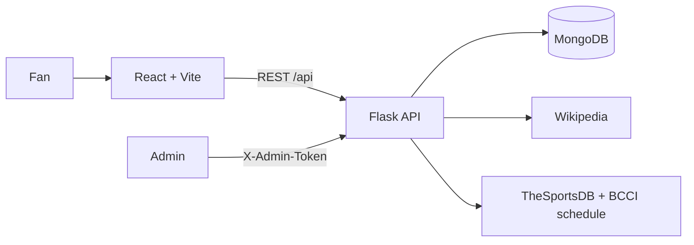

<div align="center">


<br />

### A 3D arena for the stories behind sport.

Explore Indian athletes. Catch the match-day pulse. Step into a world built to move.

<br />


<br /><br />

[ENTER THE ARENA](#-quick-start) &nbsp;·&nbsp; [EXPLORE FEATURES](#-inside-the-arena) &nbsp;·&nbsp; [API](#-api-scoreboard) &nbsp;·&nbsp; [QUALITY](#-build-checks)

</div>

<br />

<table>
<tr>
<td align="center" width="25%"><b>01</b><br />ATHLETE STORIES</td>
<td align="center" width="25%"><b>02</b><br />LIVE MATCH ENERGY</td>
<td align="center" width="25%"><b>03</b><br />INTERACTIVE 3D</td>
<td align="center" width="25%"><b>04</b><br />FLASK + REACT</td>
</tr>
</table>

## ✦ Inside the arena

<table>
<tr>
<td width="33%" valign="top">

### 🏆 The athlete tunnel
Search for Indian sportspeople, open detailed profiles, and explore biographies, stats, medals, and career highlights. Wikipedia-backed profiles link to their source.

</td>
<td width="33%" valign="top">

### ⚡ Match-day control room
Browse upcoming, live, and completed matches. See scores, venues, lineups, and timelines when the data provider has them.

</td>
<td width="33%" valign="top">

### 🪐 The 3D home ground
An interactive Three.js scene gives the landing page a little atmosphere. Athlete cards, match schedules, and an optional AI Scout round out the experience.

</td>
</tr>
</table>

<details>
<summary><b>What powers the scoreboard?</b></summary>
<br />

Saved match records combine with TheSportsDB feeds and a published India–Sri Lanka 2026 schedule. The free feed has limited coverage, and live scores and lineups depend on provider availability.

</details>

## ◈ The game plan



## 🚀 Quick start

### The kit

- Python 3.10 or newer
- Node.js 20 or newer and npm
- A MongoDB connection string (Atlas or local)

### 01 — Launch the API

Create `backend/.env` from `backend/.env.example`. Set `MONGODB_URI` to your database connection string and replace the example `ADMIN_TOKEN` with a private value.

<details open>
<summary><b>Windows · PowerShell</b></summary>

```powershell
cd backend
py -m venv .venv
.\.venv\Scripts\Activate.ps1
Copy-Item .env.example .env
python -m pip install -r requirements.txt
python app.py
```

</details>

<details>
<summary><b>macOS · Linux</b></summary>

```sh
cd backend
python3 -m venv .venv
source .venv/bin/activate
cp .env.example .env
python -m pip install -r requirements.txt
python app.py
```

</details>

The API is at `http://localhost:5000`. The sample MongoDB URI is a placeholder; replace it before starting the backend.

### 02 — Open the arena

In a second terminal:

```sh
cd frontend
npm ci
npm run dev
```

Visit the local URL Vite prints (usually `http://localhost:5173`). Vite proxies `/api` requests to Flask during development.

## 🎛️ Control panel · Environment

| Variable | Purpose |
| --- | --- |
| `MONGODB_URI` | MongoDB connection string. Required to run the backend. |
| `MONGODB_DB` | Database name; defaults to `sports_portfolio`. |
| `ADMIN_TOKEN` | Private token for athlete and match admin endpoints. |
| `CORS_ORIGINS` | Comma-separated trusted frontend origins. |
| `SPORTSDB_API_KEY` | TheSportsDB key; defaults to public key `123`. |
| `GROQ_API_KEY` | Optional key for AI Scout. |
| `GROQ_MODEL` | Optional model name used by AI Scout. |
| `VITE_API_URL` | API origin for separately hosted frontend. Never place secrets here. |

Use `backend/.env` locally and your host's environment settings in production. Keep secrets out of Git and out of frontend variables.

## 🧭 API scoreboard

Every route below is under `/api`. Admin routes require the `X-Admin-Token` header.

| Method | Route | Description |
|:---:|---|---|
| `GET` | `/health` | API and database health check. |
| `GET` | `/sports` | List catalog sports. |
| `GET` | `/athletes?sport=&q=&featured=true` | Browse saved athletes and search by name. |
| `GET` | `/athletes/<slug-or-id>` | Get a saved profile; `wikipedia-<title>` loads a Wikipedia profile. |
| `POST` | `/athletes` | Create an athlete (admin). |
| `PUT` · `DELETE` | `/athletes/<slug-or-id>` | Update or delete an athlete (admin). |
| `GET` | `/matches?date=&status=&sport=&q=` | Browse and filter matches. |
| `GET` | `/matches/<id>` | Get match details. |
| `POST` | `/matches` | Create a match (admin). |
| `PUT` · `DELETE` | `/matches/<id>` | Update or delete a match (admin). |
| `POST` | `/contact` | Submit `{ "name", "email", "message" }`. |
| `POST` | `/ai/scout` | Ask about supplied athlete facts; requires `GROQ_API_KEY`. |

<details>
<summary><b>Match request example</b></summary>

```http
GET /api/matches?date=2026-11-28&status=live&sport=Cricket
```

</details>

<details>
<summary><b>Match record shape</b></summary>

```json
{
  "sport": "Cricket",
  "competition": "Example Cup",
  "starts_at": "2026-11-18T14:00:00+05:30",
  "status": "completed",
  "home": { "name": "India" },
  "away": { "name": "Australia" },
  "score": { "home": "182/6", "away": "176/9" },
  "result": "India won by 6 runs"
}
```

</details>

## 🧪 Build checks

Backend tests use an in-memory MongoDB mock; no Atlas account or running database is needed:

```sh
cd backend
python -m pip install -r requirements.txt
python -m ruff check .
python -m pytest
```

Frontend checks use Vitest and React Testing Library:

```sh
cd frontend
npm ci
npm test
npm run build
```

GitHub Actions runs backend lint and tests, frontend tests and build, dependency review on pull requests, and secret scanning. Deployments are not automated.

## 🌐 Data transmission · Providers

- **English Wikipedia** supplies athlete search results and profile information. Coverage varies; backend internet access is required.
- **TheSportsDB** supplies fixtures and results. The public key is rate-limited; lineups and live scores appear only when available.
- **BCCI schedule** adds the published India–Sri Lanka 2026 series.
- **Operator entries** let admins supplement provider feeds with saved match records.

Provider responses can be delayed or unavailable. Match timestamps use ISO 8601 in `starts_at`.

## ☁️ Deployment

**Backend** — set environment variables in your host, then start Gunicorn from `backend/`:

```sh
gunicorn app:app
```

**Frontend** — build from `frontend/` with `npm run build` and host `dist/`. Set `VITE_API_URL` to your API origin, set backend `CORS_ORIGINS` to your frontend origin, and configure SPA fallback routing to serve `index.html` for client-side routes.

## ⚠️ Reset arena data

For a new development database, run `python reset_database.py` from `backend/` after configuring `MONGODB_URI` and `MONGODB_DB`.

> [!CAUTION]
> The reset script drops **every collection** in the configured database. Use a disposable development database only. Never run it against production or data you need.

<div align="center">

<br />

**The next great story starts at the whistle.**

</div>
