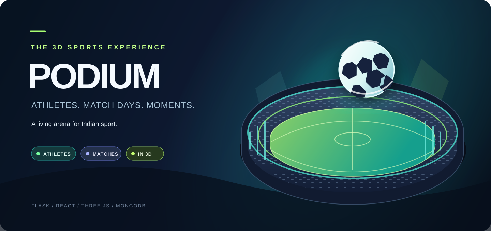
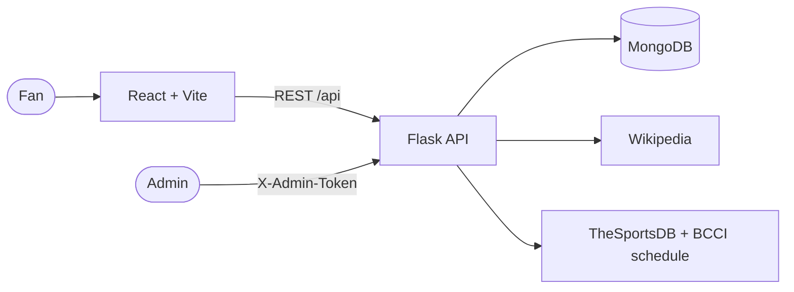

<div align="center">



<br />

# P O D I U M

**A 3D arena for the stories behind sport.**
<br />
Explore Indian athletes · Catch the match-day pulse · Step into a world built to move.

<br />


<br /><br />

[**🚀 Quick start**](#-quick-start) &nbsp;•&nbsp; [**✨ Features**](#-features) &nbsp;•&nbsp; [**🧭 Architecture**](#-architecture) &nbsp;•&nbsp; [**🔌 API**](#-api-reference) &nbsp;•&nbsp; [**🧪 Quality**](#-quality-checks) &nbsp;•&nbsp; [**🚢 Deploy**](#-deployment)

</div>

<br />

<table>
<tr>
<td align="center" width="25%"><h3>01</h3><sub><b>ATHLETE<br />STORIES</b></sub></td>
<td align="center" width="25%"><h3>02</h3><sub><b>LIVE MATCH<br />ENERGY</b></sub></td>
<td align="center" width="25%"><h3>03</h3><sub><b>INTERACTIVE<br />3D SCENE</b></sub></td>
<td align="center" width="25%"><h3>04</h3><sub><b>FLASK +<br />REACT</b></sub></td>
</tr>
</table>

<br />

## ✨ Features

<table>
<tr>
<td width="33%" valign="top">

### 🏆 The athlete tunnel

Search Indian sportspeople and open detailed profiles — biographies, stats, medals and career highlights. Wikipedia-backed profiles link straight to their source.

</td>
<td width="33%" valign="top">

### ⚡ Match-day control room

Browse **upcoming**, **live** and **completed** matches. Scores, venues, lineups and timelines appear whenever the data provider has them.

</td>
<td width="33%" valign="top">

### 🪐 The 3D home ground

An interactive **Three.js** scene gives the landing page real atmosphere. Athlete cards, match schedules and an optional **AI Scout** round out the experience.

</td>
</tr>
</table>

<details>
<summary><b>What powers the scoreboard?</b></summary>
<br />

Saved match records combine with **TheSportsDB** feeds and a published **India–Sri Lanka 2026** schedule. The free feed has limited coverage, and live scores and lineups depend on provider availability.

</details>

<br />

## 🧭 Architecture



<br />

## 🚀 Quick start

> [!NOTE]
> **You'll need:** Python 3.10+ · Node.js 20+ with npm · a MongoDB connection string (Atlas or local)

### 1 &nbsp;·&nbsp; Launch the API

Create `backend/.env` from `backend/.env.example`. Set `MONGODB_URI` to your database connection string and replace the example `ADMIN_TOKEN` with a private value.

<details open>
<summary><b>🪟 Windows · PowerShell</b></summary>

```powershell
cd backend
py -m venv .venv
.\.venv\Scripts\Activate.ps1
Copy-Item .env.example .env
python -m pip install -r requirements.txt
python app.py
```

</details>

<details>
<summary><b>🍎 macOS · 🐧 Linux</b></summary>

```sh
cd backend
python3 -m venv .venv
source .venv/bin/activate
cp .env.example .env
python -m pip install -r requirements.txt
python app.py
```

</details>

The API runs at **`http://localhost:5000`**. The sample MongoDB URI is only a placeholder — replace it before starting the backend.

### 2 &nbsp;·&nbsp; Open the arena

In a second terminal:

```sh
cd frontend
npm ci
npm run dev
```

Open the local URL Vite prints (usually **`http://localhost:5173`**). Vite proxies `/api` requests to Flask during development.

<br />

## 🔐 Configuration

| Variable | Purpose |
| :--- | :--- |
| `MONGODB_URI` | MongoDB connection string. **Required** to run the backend. |
| `MONGODB_DB` | Database name. Defaults to `sports_portfolio`. |
| `ADMIN_TOKEN` | Private token for athlete and match admin endpoints. |
| `CORS_ORIGINS` | Comma-separated trusted frontend origins. |
| `SPORTSDB_API_KEY` | TheSportsDB key. Defaults to the public key `123`. |
| `GROQ_API_KEY` | *Optional.* Key for AI Scout. |
| `GROQ_MODEL` | *Optional.* Model name used by AI Scout. |
| `VITE_API_URL` | API origin for a separately hosted frontend. |

> [!IMPORTANT]
> Use `backend/.env` locally and your host's environment settings in production. Keep secrets out of Git, and **never** place secrets in frontend (`VITE_*`) variables.

<br />

## 🔌 API reference

Every route is under **`/api`**. Admin routes require the `X-Admin-Token` header.

| Method | Route | Description | Auth |
| :---: | :--- | :--- | :---: |
| `GET` | `/health` | API and database health check | — |
| `GET` | `/sports` | List catalog sports | — |
| `GET` | `/athletes?sport=&q=&featured=true` | Browse saved athletes and search by name | — |
| `GET` | `/athletes/<slug-or-id>` | Get a saved profile; `wikipedia-<title>` loads a Wikipedia profile | — |
| `POST` | `/athletes` | Create an athlete | 🔒 Admin |
| `PUT` `DELETE` | `/athletes/<slug-or-id>` | Update or delete an athlete | 🔒 Admin |
| `GET` | `/matches?date=&status=&sport=&q=` | Browse and filter matches | — |
| `GET` | `/matches/<id>` | Get match details | — |
| `POST` | `/matches` | Create a match | 🔒 Admin |
| `PUT` `DELETE` | `/matches/<id>` | Update or delete a match | 🔒 Admin |
| `POST` | `/contact` | Submit `{ "name", "email", "message" }` | — |
| `POST` | `/ai/scout` | Ask about supplied athlete facts (needs `GROQ_API_KEY`) | — |

<details>
<summary><b>📡 Match request example</b></summary>

```http
GET /api/matches?date=2026-11-28&status=live&sport=Cricket
```

</details>

<details>
<summary><b>🧾 Match record shape</b></summary>

```json
{
  "sport": "Cricket",
  "competition": "Example Cup",
  "starts_at": "2026-11-18T14:00:00+05:30",
  "status": "completed",
  "home": { "name": "India" },
  "away": { "name": "Australia" },
  "score": { "home": "182/6", "away": "176/9" },
  "result": "India won by 6 runs"
}
```

</details>

<br />

## 🧪 Quality checks

Backend tests use an in-memory MongoDB mock — no Atlas account or running database needed.

```sh
cd backend
python -m pip install -r requirements.txt
python -m ruff check .
python -m pytest
```

Frontend checks use Vitest and React Testing Library.

```sh
cd frontend
npm ci
npm test
npm run build
```

GitHub Actions runs backend lint and tests, frontend tests and build, dependency review on pull requests, and secret scanning. Deployments are not automated.

<br />

## 🌐 Data providers

| Provider | What it supplies | Notes |
| :--- | :--- | :--- |
| **English Wikipedia** | Athlete search results and profile information | Coverage varies; backend needs internet access |
| **TheSportsDB** | Fixtures and results | Public key is rate-limited; lineups and live scores only when available |
| **BCCI schedule** | Published India–Sri Lanka 2026 series | Static schedule data |
| **Operator entries** | Admin-saved match records | Supplement provider feeds |

Provider responses can be delayed or unavailable. Match timestamps use ISO 8601 in `starts_at`.

<br />

## 🚢 Deployment

**Backend** — set environment variables in your host, then start Gunicorn from `backend/`:

```sh
gunicorn app:app
```

**Frontend** — build from `frontend/` with `npm run build` and host `dist/`.

- Set `VITE_API_URL` to your API origin
- Set backend `CORS_ORIGINS` to your frontend origin
- Configure SPA fallback routing to serve `index.html` for client-side routes

<br />

## 🧨 Reset arena data

For a fresh development database, run `python reset_database.py` from `backend/` after configuring `MONGODB_URI` and `MONGODB_DB`.

> [!CAUTION]
> The reset script drops **every collection** in the configured database. Use a disposable development database only. Never run it against production or data you need.

<br />

<div align="center">

---

**The next great story starts at the whistle.** 🏁

<sub>Built with React · Flask · Three.js · MongoDB</sub>

</div>
