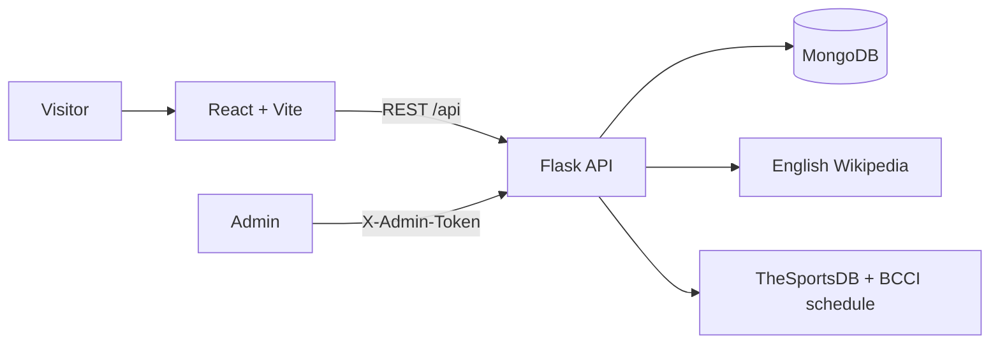

<div align="center">


<br />

### Discover athletes. Follow the game. Feel the moment.

An interactive sports portfolio for Indian athletes, match days, and the stories behind every performance.

<br />


<br /><br />

[Quick start](#-quick-start) · [Features](#-the-podium-experience) · [API](#-api-at-a-glance) · [Tests](#-quality-checks) · [Deploy](#-deployment)

</div>

---

## The Podium experience

<table>
<tr>
<td width="50%" valign="top">

### 🏅 Athlete profiles
Explore Indian athletes with biographies, stats, achievements, and source links.

### 🔎 Wikipedia search
Search English Wikipedia for Indian sportspeople and open the profiles you find.

### 🏟️ Match center
Browse upcoming, live, and completed fixtures, with scorecards and lineups when available.

</td>
<td width="50%" valign="top">

### 🪐 A little 3D magic
An interactive Three.js scene gives the home page its own orbit.

### ✍️ Admin tools
Manage athlete and match records through token-protected endpoints.

### 💬 AI Scout
Ask profile-based questions when a Groq API key is configured.

</td>
</tr>
</table>

> Match and athlete details come from external providers. Coverage, lineups, and live updates depend on provider availability.

## Under the hood



## 🚀 Quick start

### You will need

- Python 3.10 or newer
- Node.js 20 or newer with npm
- A MongoDB connection string

### 1 · Start the API

Create `backend/.env` from `backend/.env.example`. Set `MONGODB_URI` to your MongoDB connection string and replace the sample `ADMIN_TOKEN` with a private value.

**Windows PowerShell**

```powershell
cd backend
py -m venv .venv
.\.venv\Scripts\Activate.ps1
Copy-Item .env.example .env
python -m pip install -r requirements.txt
python app.py
```

**macOS / Linux**

```sh
cd backend
python3 -m venv .venv
source .venv/bin/activate
cp .env.example .env
python -m pip install -r requirements.txt
python app.py
```

The API starts at `http://localhost:5000`. The sample MongoDB URI is only a placeholder.

### 2 · Start the web app

Open a second terminal:

```sh
cd frontend
npm ci
npm run dev
```

Open the URL Vite prints (usually `http://localhost:5173`). During development, Vite forwards `/api` requests to the local Flask server.

## ⚙️ Configuration

| Variable | What it controls |
| --- | --- |
| `MONGODB_URI` | MongoDB connection string. Set this before starting the backend. |
| `MONGODB_DB` | Database name; defaults to `sports_portfolio`. |
| `ADMIN_TOKEN` | Private token for athlete and match admin endpoints. |
| `CORS_ORIGINS` | Comma-separated allowed frontend origins. |
| `SPORTSDB_API_KEY` | TheSportsDB key; defaults to the public key `123`. |
| `GROQ_API_KEY` | Optional key that enables AI Scout. |
| `GROQ_MODEL` | Optional model name for AI Scout. |
| `VITE_API_URL` | API origin for a separately hosted frontend. Do not put secrets here. |

For local development, backend values belong in `backend/.env`. In production, set them in your hosting provider's environment settings. Never commit `.env` files or expose private keys to the frontend.

## 🔌 API at a glance

All routes begin with `/api`. Admin routes require the `X-Admin-Token` header.

| Method | Route | What it does |
| :---: | --- | --- |
| `GET` | `/health` | Check API and database connectivity. |
| `GET` | `/sports` | List available sports. |
| `GET` | `/athletes?sport=&q=&featured=true` | Browse athletes and search by name. |
| `GET` | `/athletes/<slug-or-id>` | Open a saved athlete profile. |
| `POST` `PUT` `DELETE` | `/athletes` or `/athletes/<id>` | Manage athlete records (admin). |
| `GET` | `/matches?date=&status=&sport=&q=` | Browse and filter matches. |
| `GET` | `/matches/<id>` | Open match details. |
| `POST` `PUT` `DELETE` | `/matches` or `/matches/<id>` | Manage match records (admin). |
| `POST` | `/contact` | Submit a contact message. |
| `POST` | `/ai/scout` | Ask about supplied athlete profile facts. |

Example match query:

```http
GET /api/matches?date=2026-11-28&status=live&sport=Cricket
```

Example API error response:

```json
{ "error": "Match not found." }
```

## 🧪 Quality checks

Backend tests use an in-memory MongoDB mock, so no Atlas account or running database is needed:

```sh
cd backend
python -m pip install -r requirements.txt
python -m ruff check .
python -m pytest
```

Frontend tests use Vitest and React Testing Library:

```sh
cd frontend
npm ci
npm test
npm run build
```

GitHub Actions runs backend lint and tests, frontend tests and build, plus pull request dependency review and secret scanning. Deployment is not automated.

## 🏏 Match data

Podium combines saved match records with automatic provider data. The free TheSportsDB key has limited daily coverage; lineups and live scores appear only when the provider supplies them. A published India–Sri Lanka 2026 schedule is also included. Provider data can be delayed or unavailable.

Saved matches use ISO 8601 timestamps in `starts_at`:

```json
{
  "sport": "Cricket",
  "competition": "Example Cup",
  "starts_at": "2026-11-18T14:00:00+05:30",
  "status": "completed",
  "home": { "name": "India" },
  "away": { "name": "Australia" },
  "score": { "home": "182/6", "away": "176/9" },
  "result": "India won by 6 runs"
}
```

Athlete search and biographies use English Wikipedia. Results depend on Wikipedia coverage and backend internet access. Profiles link to their source article.

## 🌍 Deployment

**Backend:** configure production environment variables and start Gunicorn from the `backend/` directory:

```sh
gunicorn app:app
```

**Frontend:** build from `frontend/`, host `dist/`, and set `VITE_API_URL` to the API origin. Set backend `CORS_ORIGINS` to the frontend origin and configure the host's SPA fallback so direct route visits serve `index.html`.

## 🗄️ Database reset

To seed the sports catalog in a new development database, run from `backend/` after configuring `MONGODB_URI` and `MONGODB_DB`:

```sh
python reset_database.py
```

> [!CAUTION]
> The reset script drops **every collection** in the configured database. Use a disposable development database only. Never run it against production or a database containing data you need.

<div align="center">

<br />

**Made for the moments that move sport forward.**


</div>
