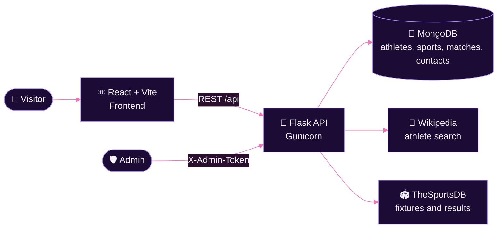

<div align="center">


<a href="https://git.io/typing-svg">
  
</a>

<br/><br/>


<br/><br/>

<a href="#-quick-start"></a>
<a href="#-features"></a>
<a href="#-api-reference"></a>
<a href="#-deploy"></a>

<br/>


</div>


## 🎯 About

**Podium** is a 3D sports portfolio where visitors explore athlete profiles, search Wikipedia for Indian sportspeople, and follow fixtures, live scores and results, all in one colourful place.

> [!NOTE]
> The sports list lives in MongoDB. Athlete search uses English Wikipedia, so results depend on Wikipedia coverage and backend internet access. Opening a result loads its photo (when available), article summary, infobox stats and career/achievement sections, and every profile links back to its source article.


## ✨ Features


## 🧱 Architecture




## 🚀 Quick Start

<table>
<tr>
<td width="50%" valign="top">

### 🐍 Backend

```bash
cd backend
python -m venv venv
source venv/bin/activate
# Windows: venv\Scripts\activate
pip install -r requirements.txt
cp .env.example .env
python app.py
```

API runs on `http://localhost:5000`

</td>
<td width="50%" valign="top">

### ⚛️ Frontend

```bash
cd frontend
npm install
npm run dev
```

Open the local URL Vite prints in your terminal

</td>
</tr>
</table>

> [!TIP]
> Folder names (`backend/`, `frontend/`) and `.env.example` should match your repo. Edit the commands if yours differ.

## 🔧 Environment Variables

| Variable | Where | Purpose |
|---|:-:|---|
| `MONGODB_URI` | 🐍 backend | MongoDB connection string |
| `MONGODB_DB` | 🐍 backend | Database name |
| `ADMIN_TOKEN` | 🐍 backend | Secret for admin endpoints and the Schedule manager |
| `SPORTSDB_API_KEY` | 🐍 backend | Your TheSportsDB key (optional, defaults to free key `123`) |
| `CORS_ORIGINS` | 🐍 backend | Your frontend site URL |
| `VITE_API_URL` | ⚛️ frontend | URL of the deployed API |


## ⚽ Match Center

The **Matches** page lists upcoming, live and completed fixtures. Each match can show:

| 👥 Lineups | 📍 Venue | 🔢 Score summary | 📊 Scorecard | ⏱️ Timeline |
|:-:|:-:|:-:|:-:|:-:|
| Team players | Where it's played | Quick result | Per-period breakdown | Key events |

Match records live in the `matches` collection. Use the **Schedule manager** on the page to add or update a match (needs the configured `ADMIN_TOKEN`). Scoreboard fields are intentionally flexible so they fit different sports.

<details>
<summary><b>📦 Example match record (click to expand)</b></summary>

```json
{
  "sport": "Cricket",
  "competition": "Example Cup",
  "starts_at": "2026-11-18T14:00:00+05:30",
  "status": "completed",
  "venue": "Mumbai",
  "home": { "name": "India", "players": ["Player One", "Player Two"] },
  "away": { "name": "Australia", "players": ["Player Three", "Player Four"] },
  "score": {
    "home": "182/6 (20 ov)",
    "away": "176/9 (20 ov)",
    "summary": "India won by 6 runs",
    "periods": [{ "label": "Innings 1", "home": "182/6", "away": "176/9" }],
    "events": [{ "time": "19.4 ov", "text": "Wicket" }]
  },
  "result": "India won by 6 runs"
}
```

</details>

### 📡 Data sources

| Source | What it gives |
|---|---|
| 🌐 **TheSportsDB** | Automatic fixtures and results, refreshed every 90 seconds. The free key `123` has restricted daily results, and lineups appear when the provider has them |
| 🏏 **BCCI schedule** | The published India–Sri Lanka 2026 series, included so it stays discoverable beyond the daily result limit |
| ✍️ **Operator entries** | Admin-entered records that supplement the feed |

> [!TIP]
> Set `SPORTSDB_API_KEY` in `backend/.env` to use your own key. Premium keys unlock broader schedules and the provider's live-score API.


## 🔌 API Reference

### 🏃 Athletes, Sports and Contact

| Method | Endpoint | Notes |
|:-:|---|---|
|  | `/api/athletes` | `?sport=` `?q=` `?featured=true` |
|  | `/api/athletes/<slug or id>` | Single athlete |
|  | `/api/sports` | All sports |
|    | `/api/athletes` | 🔐 needs header `X-Admin-Token` |
|  | `/api/contact` | `name`, `email`, `message` |

### ⚽ Matches

| Method | Endpoint | Notes |
|:-:|---|---|
|  | `/api/matches` | Filters: `q`, `date`, `status`, `sport` |
|  | `/api/matches/<id>` | Single match |
|  | `/api/matches` | 🔐 `X-Admin-Token` |
|  | `/api/matches/<id>` | 🔐 `X-Admin-Token` |
|  | `/api/matches/<id>` | 🔐 `X-Admin-Token` |

```http
GET /api/matches?q=India%20vs%20Sri%20Lanka
GET /api/matches?date=YYYY-MM-DD&status=live&sport=Cricket
```


## 🔐 Admin Guide

### ➕ Add an athlete

```bash
curl -X POST localhost:5000/api/athletes \
  -H "Content-Type: application/json" \
  -H "X-Admin-Token: YOUR_TOKEN" \
  -d '{"name":"New Athlete","slug":"new-athlete","sport":"Tennis","medals":{"gold":1,"silver":0,"bronze":0}}'
```

### 🧹 Reset the database

To intentionally replace all data and reload the sports list (with no starter athlete profiles), run from `backend/`:

```bash
python reset_database.py
```

> [!CAUTION]
> This **drops every collection** in `MONGODB_DB` before recreating the sports, an empty athlete collection and an empty contact-message collection. It cannot be undone.


## 🌍 Deploy

<table>
<tr>
<td width="50%" valign="top">

### 🐍 API
**Render / Railway**

```bash
gunicorn app:app
```

- Set the `.env` values as environment variables
- Put your site URL in `CORS_ORIGINS`

</td>
<td width="50%" valign="top">

### ⚛️ Frontend
**Netlify / Vercel**

```bash
npm run build
```

- Host the `dist/` folder
- Set `VITE_API_URL` to your API URL

</td>
</tr>
</table>


