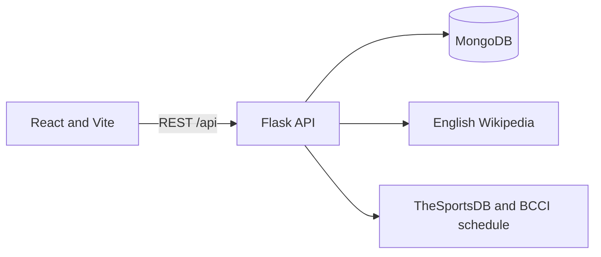

# Podium

Podium is a sports portfolio for exploring Indian athlete profiles and match
fixtures. It uses a React and Vite frontend, a Flask API, and MongoDB. Athlete
search uses English Wikipedia; automatic fixtures and results use TheSportsDB
and selected published BCCI schedules.

## Features

- Athlete directory with sport filters, search, and profile pages.
- Match center for upcoming, live, and completed fixtures.
- Admin forms for managing athlete and match records.
- Contact form and optional AI Scout endpoint.
- Interactive 3D scene on the home page.

## Architecture



## Requirements

- Python 3.10 or newer
- Node.js 20 or newer and npm
- MongoDB connection string (Atlas or a local MongoDB server)

## Local setup

### 1. Configure the backend

Create `backend/.env` from the example and set a real MongoDB connection string
and a long, private admin token. Do not commit `.env`.

Windows PowerShell:

```powershell
cd backend
py -m venv .venv
.\.venv\Scripts\Activate.ps1
Copy-Item .env.example .env
python -m pip install -r requirements.txt
python app.py
```

macOS/Linux:

```sh
cd backend
python3 -m venv .venv
source .venv/bin/activate
cp .env.example .env
python -m pip install -r requirements.txt
python app.py
```

The API runs at `http://localhost:5000`. The sample `MONGODB_URI` is a
placeholder; replace it before starting the backend.

### 2. Start the frontend

In a second terminal:

```sh
cd frontend
npm ci
npm run dev
```

Open the local URL printed by Vite (usually `http://localhost:5173`). During
development, Vite proxies `/api` requests to `http://localhost:5000`.

## Environment variables

| Variable | Required | Purpose |
| --- | --- | --- |
| `MONGODB_URI` | Yes | MongoDB connection string. |
| `MONGODB_DB` | No | Database name; defaults to `sports_portfolio`. |
| `ADMIN_TOKEN` | Yes for admin features | Private token used by admin API requests. |
| `CORS_ORIGINS` | No | Comma-separated trusted frontend origins; defaults to `http://localhost:5173`. |
| `SPORTSDB_API_KEY` | No | TheSportsDB API key; the public key `123` is used by default. |
| `GROQ_API_KEY` | No | Enables the AI Scout endpoint when configured. |
| `GROQ_MODEL` | No | Groq model name used by AI Scout. |
| `VITE_API_URL` | For separate frontend hosting | Base URL of the deployed API, without `/api`. Do not put secrets here. |

The backend reads its environment from `backend/.env` for local development.
In production, configure these values in the hosting provider's environment
settings.

## Tests and CI

Backend tests use an in-memory MongoDB mock and do not require a running MongoDB
server or external data providers:

```sh
cd backend
python -m pip install -r requirements.txt
python -m ruff check .
python -m pytest
```

Frontend tests use Vitest and React Testing Library:

```sh
cd frontend
npm ci
npm test
npm run build
```

GitHub Actions runs backend lint and tests, frontend tests and build, dependency
review on pull requests, and secret scanning. Deployment is not automated.

## API reference

All endpoints are prefixed with `/api`. Admin endpoints require the
`X-Admin-Token` request header.

| Method | Endpoint | Purpose |
| --- | --- | --- |
| `GET` | `/api/health` | API and database health check. |
| `GET` | `/api/sports` | List sports in the catalog. |
| `GET` | `/api/athletes?sport=&q=&featured=true` | List saved athletes and search Wikipedia for matching names. |
| `GET` | `/api/athletes/<slug-or-id>` | Get an athlete profile. `wikipedia-<title>` loads a Wikipedia profile. |
| `POST` | `/api/athletes` | Create an athlete (admin). |
| `PUT` | `/api/athletes/<slug-or-id>` | Update an athlete (admin). |
| `DELETE` | `/api/athletes/<slug-or-id>` | Delete an athlete (admin). |
| `GET` | `/api/matches?date=&status=&sport=&q=` | List and filter fixtures. |
| `GET` | `/api/matches/<id>` | Get a saved or supported provider match. |
| `POST` | `/api/matches` | Create a match (admin). |
| `PUT` | `/api/matches/<id>` | Update a match (admin). |
| `DELETE` | `/api/matches/<id>` | Delete a match (admin). |
| `POST` | `/api/contact` | Submit `{ "name", "email", "message" }`. |
| `POST` | `/api/ai/scout` | Ask about a supplied athlete profile (requires `GROQ_API_KEY`). |

Example successful create response:

```json
{ "id": "..." }
```

Example error response:

```json
{ "error": "Athlete not found." }
```

## Match data and limitations

The match center combines saved operator entries with provider data. The free
TheSportsDB key has limited daily coverage; lineups and live scores depend on
provider availability. A published India-Sri Lanka 2026 schedule is also
included. Search results and profile details depend on Wikipedia's coverage and
backend internet access. Provider data may be delayed or unavailable.

Match records use ISO 8601 timestamps in `starts_at`, for example:

```json
{
  "sport": "Cricket",
  "competition": "Example Cup",
  "starts_at": "2026-11-18T14:00:00+05:30",
  "status": "completed",
  "home": { "name": "India" },
  "away": { "name": "Australia" },
  "score": { "home": "182/6", "away": "176/9" },
  "result": "India won by 6 runs"
}
```

## Database setup and reset

The application creates indexes when it receives its first request. To seed the
sports catalog in a new database, run `python reset_database.py` from `backend/`
after setting `MONGODB_URI` and `MONGODB_DB`.

**This reset script drops every collection in the configured database.** Use a
disposable development database only; do not run it against production or any
database containing data you need. Back up important data before any manual
database changes.

## Deployment

For the backend, set the production environment variables in the hosting
provider and start Gunicorn from the `backend/` directory:

```sh
gunicorn app:app
```

For the frontend, run `npm run build` from `frontend/` and host the generated
`dist/` directory. Set `VITE_API_URL` to the API origin and configure the
backend's `CORS_ORIGINS` to include the frontend origin. Configure SPA fallback
routing in the frontend host so direct visits to client-side routes serve
`index.html`.
